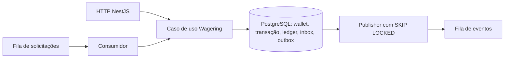

# Arquitetura e decisões

## Estado e composição

A etapa final foi validada em Linux: 81 testes, 261 asserções, build com lockfile congelado, tipos estritos e formatação. Demonstração completa também executada sobre PostgreSQL vazio em projeto Compose separado.

`src/domain` contém Money, Wallet, WalletLedgerEntry, WagerTransaction, InboxMessage, OutboxMessage e eventos, sem framework/ORM. Factories de criação validam entradas; rehydrate reconstrói estados persistidos. Snapshots e payloads de eventos são copiados e congelados. `application` compartilha o caso de uso entre HTTP/SQS por portas; `bootstrap` compõe NestJS; infraestrutura implementa banco, filas e loops. Não há correção financeira baseada em memória de processo.

## Dinheiro

Money usa bigint em centavos e strings decimais na persistência/borda, sem arredondamento silencioso. HTTP aceita BRL com exatamente duas casas. NUMERIC(30,2) limita valores a 28 dígitos inteiros; o domínio verifica capacidade antes da gravação. Crédito que excederia o saldo máximo termina como BALANCE_LIMIT_EXCEEDED sem ledger ou alteração da versão. BET/WIN/REFUND/ROLLBACK exigem valor positivo; LOSS exige zero e não movimenta saldo. OPENING é interno.

MikroORM mapeia WalletRow por EntitySchema/Unit of Work. Ledger, transações, inbox e outbox usam SQL parametrizado no mesmo EntityManager. Migrations explícitas preservam constraints e triggers; não executar schema:update.

## Atomicidade e concorrência

Cada operação usa EntityManager fork, transação SQL e SELECT FOR UPDATE por wallet; lock_timeout=5s e statement_timeout=15s. Carteiras diferentes progridem em paralelo. Abertura positiva grava OPENING, crédito e evento; abertura zero não cria ledger. Toda abertura começa na versão 1. Movimento confirma transação, saldo/versão, ledger, inbox e eventos de forma atômica; ack ocorre depois do commit.

O schema protege unicidade de player/moeda, identidade externa, chave idempotente, lançamento por operação/carteira e reversão processada por referência/tipo. CHECKs e FKs compostas validam aritmética, valor/moeda e vínculo financeiro. Triggers impedem UPDATE/DELETE/TRUNCATE do ledger, transição de operação terminal e alteração indevida de versão. Constraints diferidas conferem no commit o saldo agregado e a quantidade/valor de lançamentos.

Custo assumido: a verificação agregada soma o histórico da wallet a cada movimento; o experimento curto não mede históricos extensos. Ela não prova continuidade cronológica de cada balanceBefore/balanceAfter. Administradores podem desativar triggers; produção exige segregação de privilégios. Ledger registra movimentos por wallet, sem implementar contabilidade de partidas dobradas.

## Idempotência e inbox

Idempotency-Key é obrigatória no HTTP. SHA-256 recebe JSON canônico dos campos de negócio validados, com chaves ordenadas, UUIDs normalizados e strings monetárias preservadas. Campos desconhecidos são rejeitados. A chave fica fora do hash.

Mesma chave/hash retorna ID e resposta financeira persistida, com idempotentReplay=true, inclusive o saldo original. Mesma chave/payload divergente ou outra chave para identidade externa já utilizada gera 409. Constraints SQL resolvem disputas entre instâncias. O estado de entrada é copiado antes da operação, evitando mutação terminal no chamador após rollback.

InboxMessage deduplica consumerName/messageId e verifica hash do envelope. Processamento e marcação da inbox ocorrem na mesma transação financeira. Inbox não substitui idempotência: mensagens distintas podem solicitar a mesma operação. Replay preserva o primeiro processedAt.

## Referências

Referência usa providerId/externalTransactionId e confere wallet, player, moeda e rodada. Ausente/não terminal: PENDING_REFERENCE; referência rejeitada/falha: REFERENCE_REJECTED. WIN/LOSS com referência exigem BET. REFUND reverte BET; ROLLBACK reverte BET/WIN/REFUND. Reversão integral e única por tipo. Débito de reversão sem saldo recebe REVERSAL_INSUFFICIENT_FUNDS, distinto da aposta sem saldo.

Tentativas e next_reference_at são persistidos com relógio PostgreSQL, backoff de 2s até 1h, dez tentativas ou TTL de 24h. Esgotamento rejeita com REFERENCE_NOT_FOUND. Workers reavaliam estado/due sob lock; espera repetida não publica novo evento pending.

## Broker e recuperação

Filas FIFO separadas: wager-transactions.fifo, wager-transactions-dlq.fifo e wager-events.fifo. FIFO auxilia ordenação/dedup por tempo limitado; PostgreSQL dá a garantia financeira. SDK usa endpoint configurado e timeouts de conexão/requisição. Consumidor recebe uma mensagem por poll, visibilidade 30s, heartbeat 10s, retry exponencial até 60s e no máximo cinco entregas antes da DLQ. Erro de negócio é terminal com ack; envelope inválido/conflito permanente segue para DLQ. Publicação na DLQ falhou: sem ack.

Ao esgotar falha de infraestrutura, o consumidor tenta registrar FAILED/INFRASTRUCTURE_FAILURE e evento de falha, sem movimento financeiro. Se o banco estiver indisponível, registra failure_audit_deferred e preserva o envelope na DLQ para análise; não afirma ter gravado FAILED. Replay de FAILED permanece terminal.

OutboxMessage encapsula agendamento, retry e conclusão. Publisher reivindica um evento devido com FOR UPDATE SKIP LOCKED, mantém o lock durante o envio e só marca published_at após sucesso. Retry exponencial até 60s, sem descarte automático. Cada ciclo publica até 25 itens antes da pausa de 250ms; vários publishers compartilham a fila SQL. Falha após envio e antes do commit permite duplicata com eventId estável: consumidor externo precisa de deduplicação persistente. Não há promessa de exactly-once no broker.

Eventos: WagerTransactionProcessed, WagerTransactionRejected, WagerTransactionPendingReference, WagerTransactionFailed e WalletBalanceChanged. Não há publicação antes do commit financeiro. Testes encerram processos nas janelas após commit/antes de ack, após commit financeiro/antes da publicação e após envio/antes de marcar publicação. Nesta última, dedup FIFO é deliberadamente contornada para provar dedup persistente do assinante.

## HTTP, métricas e shutdown

HTTP: 400 contrato inválido, 404 inexistente, 409 conflito, 422 rejeição, 202 pendência, 503 infraestrutura transitória e 500 falha terminal ou inesperada. Timeout real de lock foi testado: 503 e repetição segura da mesma chave após liberar o lock.

Ledger usa cursor opaco vinculado à wallet, ordem created_at com microssegundos/id, limite de 1 a 100. Reconciliação lê saldo e soma sob lock, retorna diferença e nunca corrige silenciosamente.

Logs JSON usam correlationId e IDs disponíveis sem corpo financeiro completo. X-Correlation-Id é validado/gerado; SQS usa messageId. Métricas por instância cobrem latência, status, replay, retries, DLQ e conflitos de lock. Outbox pending/lag consultam o backlog global no banco, atualizados pelos publishers; não são amostragem contínua. Contadores reiniciam com o processo. A carga mede contadores da API, sem alegar agregar workers.

SIGTERM/SIGINT interrompem novos polls e aguardam operações em andamento antes de fechar ORM/broker; Compose concede 45s. Teste Linux envia SIGTERM durante operação financeira e verifica commit/ack. Liveness é pública; readiness confere PostgreSQL e filas.

## Limites e decisões

Autenticação externa foi adiada conforme permitido pelo enunciado. DevelopmentProviderIdentity é no-op; ProviderIdentityPort permite validar OIDC/IdP e vínculo do provider no token, sem tabela artesanal de senhas. Não expor esta configuração à internet como produção.

LocalStack é emulador: filas não persistem entre reinicializações nesta configuração. PostgreSQL usa volume persistente. Eventos da outbox permanecem registrados, inclusive publicados, mas não existe replay operacional automático de eventos já marcados como publicados após perda das filas do emulador. Essa limitação local difere da durabilidade esperada do serviço SQS. Não apagar volumes para recuperar falhas.

O ensaio de carga evidenciou backlog com um publisher e drenagem com três. São execuções locais curtas, sequenciais, com histórico crescente e recursos compartilhados; não estabelecem capacidade de produção nem ganho linear. Detalhes em docs/PERFORMANCE.md. CI configurada para build, formato, tipos e testes a cada push/pull request. Rastreabilidade em docs/AUDIT.md.

## Guia visual

A visão geral desta arquitetura está em docs/diagrams/arquitetura.svg. O guia docs/diagrams/arquitetura.html permite explorar cada componente, abrir seus arquivos e comparar seis caminhos de uma operação. É documentação didática offline; seus exemplos não executam o sistema. O diagrama não substitui as invariantes SQL ou os testes de integração.
