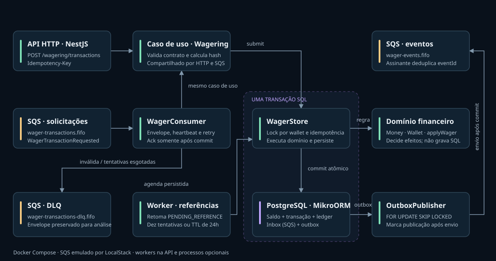

# Jungle Gaming — Distributed Wagering Processor

Processador financeiro com Bun 1.4.3, TypeScript estrito, NestJS, PostgreSQL 17, MikroORM 6.6.17 e SQS via LocalStack. [Enunciado](https://github.com/junglegaming/backend-challenge).

## Executar

Requisito: Docker com engine Linux e Compose. Não exige Bun no host.

```sh
docker compose build api
docker compose up -d api
```

O Compose inicia as dependências, aplica migrations e sobe HTTP e workers. API: http://localhost:3100; readiness: `/health/ready`; liveness: `/health/live`; métricas: `/metrics`. Portas configuráveis: `API_PORT`, `POSTGRES_PORT`, `SQS_PORT`. Aguarde a API ficar saudável em `docker compose ps`.

Para três instâncias de processamento (API com workers e dois processos adicionais):

```sh
docker compose --profile scaled up -d --scale worker=2 api worker
```

`docker compose down` preserva o volume PostgreSQL. `down -v` remove o histórico. As filas do emulador LocalStack são efêmeras nesta configuração; reiniciar o emulador pode perder mensagens, mesmo preservando PostgreSQL. Veja os limites em [ARCHITECTURE.md](ARCHITECTURE.md).

## Verificar e demonstrar

Após o build:

```sh
docker compose --profile test run --rm tests
docker compose --profile test run --rm tests bun run typecheck
docker compose --profile test run --rm tests bun run format:check
docker compose --profile tools run --rm tools bun run demo
docker compose --profile tools run --rm tools bun run test:load
```

A suíte Linux aprovou **81 testes, 261 asserções**, incluindo PostgreSQL/SQS reais, três processos Bun, concorrência financeira e falhas abruptas. Os testes criam bancos `wager_test_<uuid>` e filas exclusivas, removendo apenas seus recursos; o usuário de testes precisa de `CREATEDB`. O teste de SIGTERM exige Linux.

A demonstração valida duplicatas, conflito de payload, disputa por saldo, referência fora de ordem, entrada SQS, reconciliação e recuperação. Demonstração e carga criam dados identificados na aplicação local e não os apagam. Relatórios são escritos em `docs/reports`.

Carga: quatro cenários de 500 pedidos, concorrência 20, percentis HTTP e conferência dos saldos. Ajuste `LOAD_REQUESTS` e `LOAD_CONCURRENCY` no ambiente do serviço tools. Para registrar o ensaio com os dois workers adicionais ativos:

```sh
docker compose --profile tools run --rm -e PROCESSING_INSTANCES=3 -e REPORT_NAME=load-scaled tools bun run test:load
```

`PROCESSING_INSTANCES` registra a topologia; não inicia processos. Os [resultados e limites](docs/reviews/008-demonstracao-carga.md) incluem o backlog de saída: capacidade HTTP não equivale a capacidade de publicação.

## Contratos e garantias

| Método | Rota | Finalidade |
|---|---|---|
| POST | /wallets | Carteira e abertura contábil |
| GET | /wallets/:id | Saldo e versão |
| GET | /wallets/:id/ledger | Histórico com cursor opaco |
| POST | /wallets/:id/reconciliation | Comparar saldo e ledger |
| POST | /wagering/transactions | Operação com Idempotency-Key |
| GET | /wagering/transactions/:id | Consulta por ID interno |
| GET | /providers/:provider/wagering/transactions/:external | Consulta por ID externo |

Dinheiro exige string com duas casas, BRL e até 28 dígitos inteiros; playerId/walletId são UUIDs. Saldo nunca negativo; ledger imutável; idempotência persistida; transação SQL única para movimento, inbox e outbox. Entrega de eventos é pelo menos uma vez: assinantes devem deduplicar `eventId` persistentemente.

[API e erros](docs/API.md) · [Arquitetura](ARCHITECTURE.md) · [Matriz de requisitos](docs/AUDIT.md) · [Roteiro de apresentação](docs/PRESENTATION.md).

Autenticação externa foi adiada conforme permitido pelo desafio. `ProviderIdentityPort` é a extensão para IdP externo; a identidade de desenvolvimento não autentica provedores. Este ambiente não deve ser exposto como serviço de produção.

## Desenvolvimento

```sh
bun install --frozen-lockfile
docker compose up -d postgres localstack
bun run db:up
bun run dev
bun test tests/unit
bun run test:integration
bun run typecheck
bun run format:check
```

`.env.example` documenta os defaults. Fora de Docker, PostgreSQL/SQS usam localhost; HTTP usa `PORT` (3000). Evite dois conjuntos de workers consumindo as mesmas filas durante depuração; `WORKERS_ENABLED=false` permite apenas HTTP. Use `bun run format` antes de revisar alterações.

`bun run db:down` reverte a última migration; use banco descartável ou backup. Nunca substitua migrations por `schema:update`. O lockfile foi gerado no Linux e o build exige `--frozen-lockfile`.

A [CI](.github/workflows/ci.yml) verifica build, formato, tipos e testes reais em Docker. O workflow foi preparado; sua execução remota depende do próximo push. [Registros de revisão](docs/reviews/007-auditoria-final.md) e [instruções de entrega](docs/DELIVERY.md). Nenhum envio ao recrutador foi feito.

## Mapa visual para ler o código



Abra [o guia interativo](docs/diagrams/arquitetura.html) no navegador a partir do checkout local. No GitHub, o HTML aparece como código; a imagem acima mostra a visão estática. No guia, selecione um componente para encontrar seus arquivos e use a aba de fluxo para comparar sucesso, replay, conflito, saldo insuficiente, referência pendente e LOSS. Os exemplos não executam requisições na API. O arquivo funciona offline e permite salvar SVG ou imprimir em PDF.

No PowerShell, dentro da pasta do projeto:

```powershell
Start-Process .\docs\diagrams\arquitetura.html
```
